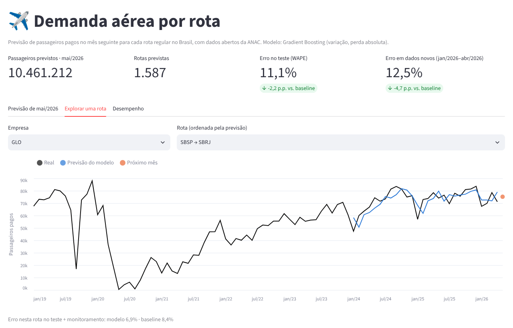
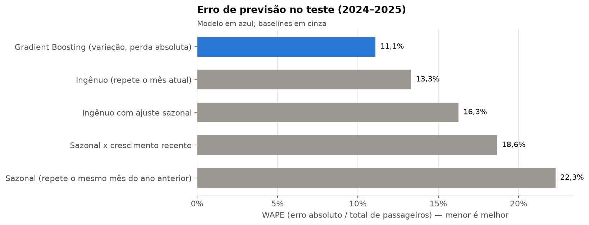
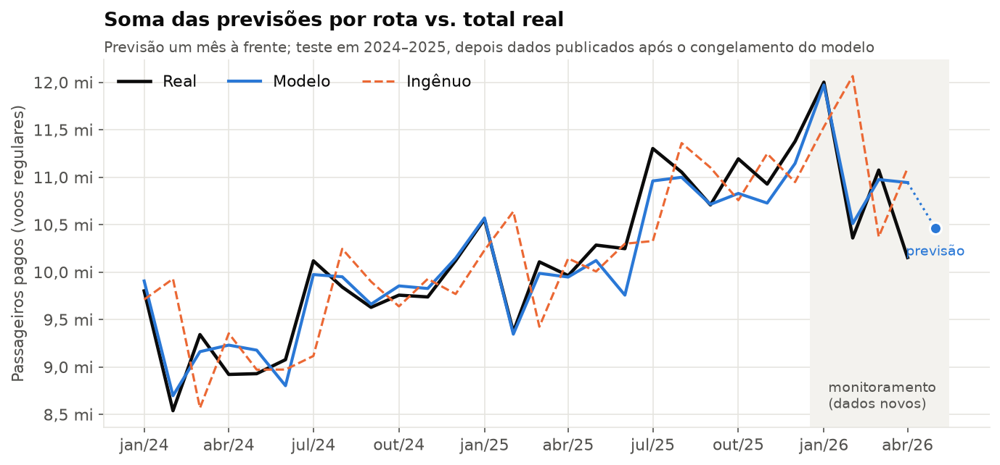

# ✈️ Flight Demand Forecasting

**Previsão mensal de passageiros por empresa e rota aérea com dados abertos da ANAC.**

[](https://github.com/megusta01/flight-demand-forecasting/actions/workflows/ci.yml)
[](pyproject.toml)
[](LICENSE)

Este projeto transforma o histórico do transporte aéreo em previsões de passageiros pagos para o mês seguinte. O pipeline reúne ingestão e validação, engenharia de atributos, comparação com baselines, seleção de modelos, avaliação temporal, persistência de artefatos e visualização em Streamlit.

Na execução documentada, o modelo alcançou **11,09% de WAPE no teste de 2024–2025**, contra **13,31% do melhor baseline**: uma redução relativa de **16,63% no erro**.



> Os resultados abaixo correspondem ao snapshot descrito em `data/README.md`, com dados até abril de 2026. A previsão de maio de 2026 é uma saída histórica dessa execução; ela não representa uma previsão atualizada em tempo real.

## O problema

**Como estimar quantos passageiros uma rota transportará no próximo mês a partir de seu histórico?**

A previsão pode apoiar análises de oferta e demanda, identificar padrões sazonais e orientar investigações sobre rotas. O projeto é uma demonstração de ciência de dados e engenharia de ML; seu desempenho mede a previsão de passageiros transportados, sem quantificar retorno financeiro ou impacto operacional.

Cada série é definida por **empresa + aeroporto de origem + aeroporto de destino**. A direção importa: origem → destino e destino → origem são séries distintas. O painel usa voos regulares e contempla a natureza doméstica e internacional presente na base da ANAC.

- **Alvo:** passageiros pagos no mês seguinte (`t+1`).
- **Informação utilizada:** histórico observado até o mês-base (`t`) e calendário do mês previsto.
- **Horizonte:** um mês à frente.
- **Cobertura de inferência:** séries com passageiros no mês-base.

## Resultados

Os valores foram extraídos de [`reports/metricas.json`](reports/metricas.json). Os relatórios e gráficos são gerados pelo pipeline.

### Teste temporal: janeiro de 2024 a dezembro de 2025

| Modelo / baseline | WAPE ↓ | MAE ↓ (passageiros por série/mês) | RMSE ↓ |
|---|---:|---:|---:|
| **Gradient Boosting — variação, perda absoluta** | **11,09%** | **701,07** | **1.467,19** |
| Ingênuo — repete o mês atual | 13,31% | 840,92 | 1.690,98 |
| Ingênuo com ajuste sazonal | 16,26% | 1.027,52 | 2.187,48 |
| Sazonal × crescimento recente | 18,65% | 1.178,60 | 2.424,51 |
| Sazonal — mesmo mês do ano anterior | 22,28% | 1.408,12 | 2.720,10 |

A redução relativa é `1 − WAPE_modelo / WAPE_baseline = 16,63%`; a diferença absoluta é **2,21 pontos percentuais**. WAPE não deve ser interpretado como “acurácia”.



### Monitoramento: janeiro a abril de 2026

O modelo final, retreinado com meses-alvo até dezembro de 2025, foi avaliado nos meses posteriores a esse corte.

| Indicador | Modelo | Baseline ingênuo |
|---|---:|---:|
| WAPE | **12,55%** | 17,29% |
| MAE | **813,04** | 1.120,42 |
| RMSE | **1.490,44** | 1.933,80 |

Esse monitoramento é uma avaliação retrospectiva em dados posteriores ao corte de treino; não demonstra uma implantação acompanhada em tempo real.

Na execução de referência, foram geradas previsões de **10.461.212 passageiros para maio de 2026**, em **1.587 séries ativas**. Esse total cobre as séries elegíveis à previsão, e não necessariamente todo o mercado.



Detalhes: [resultados](reports/resultados.md) · [model card](reports/model_card.md) · [análise exploratória](reports/eda.md).

## Dados e escopo

Fonte: [ANAC — Dados Estatísticos do Transporte Aéreo](https://www.anac.gov.br/acesso-a-informacao/dados-abertos/areas-de-atuacao/voos-e-operacoes-aereas/dados-estatisticos-do-transporte-aereo).

A execução documentada usa o arquivo identificado em `data/README.md` como **“Atualizado em: 2026-06-21”**, com observações de **janeiro de 2000 a abril de 2026**. O relatório exploratório registra **1.087.033 linhas na base carregada**, antes do recorte do painel para voos regulares.

O CSV bruto não é incluído no Git. A aquisição é manual; o pipeline localiza o primeiro arquivo `.csv`, em ordem alfabética, de `data/raw/`. Mantenha apenas o CSV desejado nessa pasta.

A ingestão detecta cabeçalho, separador e codificação, normaliza colunas, converte números e valida o esquema. Dados limpos e atributos são armazenados em Parquet para reutilização.

## Metodologia

### Painel e atributos

Os registros são agregados por empresa, origem, destino e mês. Para cada mês com passageiros, o painel constrói atributos até `t` e associa o alvo em `t+1`. Quando a série deixa de operar dentro do histórico observado, o alvo pode ser zero. As linhas do último mês disponível ficam sem alvo e são usadas na inferência.

O modelo utiliza **31 atributos numéricos e 7 categóricos**:

| Grupo | Exemplos |
|---|---|
| Demanda histórica | Defasagens de passageiros, médias de 3 e 12 meses, crescimento anual |
| Histórico relativo | Defasagens e oferta divididas pelos passageiros do mês-base |
| Sazonalidade | Mês previsto e variações sazonais observadas nos anos anteriores |
| Oferta realizada | Assentos, decolagens e ocupação do mês-base |
| Identificação | Empresa, aeroportos, regiões e natureza do voo |
| Mercado | Volume agregado observado e crescimento anual |

As defasagens e janelas são calculadas com matrizes NumPy. Categorias raras ou novas são tratadas no pré-processamento, ajustado a partir dos dados de treino. Há testes de defasagens, construção do alvo e alteração de passageiros do mês-alvo para verificar que os atributos numéricos dessa previsão não se alteram.

### Avaliação temporal

A divisão usa o **mês-alvo**, sem embaralhamento aleatório.

| Etapa | Meses-alvo | Linhas na execução de referência | Finalidade |
|---|---|---:|---|
| Treino inicial | Até dezembro de 2022 | 527.054 | Ajuste dos candidatos |
| Validação | Janeiro–dezembro de 2023 | 18.917 | Seleção de modelo e decisão sobre COVID |
| Teste | Janeiro de 2024–dezembro de 2025 | 38.117 | Avaliação após seleção |
| Monitoramento | Janeiro–abril de 2026 | 6.728 | Avaliação do modelo final após seu corte de treino |
| Inferência | Maio de 2026 | 1.587 | Previsão do próximo mês do snapshot |

O tamanho do treino inicial é anterior à exclusão dos meses de COVID. O processo segue estas etapas:

1. Compara cinco candidatos e quatro baselines na validação.
2. Verifica, para o candidato escolhido, se remover os meses-alvo de março de 2020 a dezembro de 2021 melhora o WAPE de validação.
3. Retreina em treino + validação e avalia no teste.
4. Retreina o modelo final com treino + validação + teste e salva o artefato.
5. Usa o modelo final no monitoramento e na inferência.

**As métricas de teste pertencem ao avaliador treinado até 2023.** O arquivo `artifacts/modelo.joblib` é o modelo final, treinado até 2025; suas métricas fora desse corte são as de monitoramento.

A avaliação é de um passo à frente: uma previsão para determinado mês utiliza o histórico efetivamente observado até o mês anterior. Não é uma previsão recursiva de todo o período feita em uma única data.

### Modelos e métrica

Foram comparados Ridge com alvo em log, HistGradientBoosting com alvo em log, perda Poisson e duas variantes que preveem a razão de passageiros entre meses. O vencedor usa **HistGradientBoostingRegressor com perda absoluta**, alvo `pax[t+1] / pax[t]` e peso amostral `pax[t]`.

A previsão é reconstruída como `pax[t] × razão_prevista`. A perda absoluta ponderada se relaciona ao erro absoluto em passageiros e ao numerador do WAPE. Na implementação, o alvo de razão é limitado ao intervalo `[0, 5]` no treino; por isso, a equivalência com o alvo original tem essa ressalva para crescimentos extremos.

A métrica principal é:

$$\mathrm{WAPE} = \frac{\sum_i |y_i - \hat y_i|}{\sum_i y_i}$$

WAPE mede erro relativo ao volume total e dá maior influência às séries de maior volume. MAE, RMSE, viés e análises por porte e mês complementam a avaliação.

## Como executar

### 1. Instalar

Requer **Python 3.11 ou superior**. Execute os comandos na raiz do repositório.

```bash
git clone https://github.com/megusta01/flight-demand-forecasting.git
cd flight-demand-forecasting
python -m venv .venv
```

Ative o ambiente:

```bash
# Linux / macOS
source .venv/bin/activate

# Windows — PowerShell
.venv\Scripts\Activate.ps1
```

```bash
python -m pip install --upgrade pip
python -m pip install -e ".[dev,app]"
anac-demanda --help
```

### 2. Explorar o painel sem baixar o CSV

As saídas de demonstração estão incluídas na versão de referência. Mantendo `outputs/` e `reports/metricas.json` no repositório, o painel pode ser aberto sem retreinar e sem carregar o modelo serializado:

```bash
streamlit run app/painel.py
```

Abra o endereço exibido no terminal, normalmente `http://localhost:8501`. O painel permite filtrar previsões, explorar históricos e consultar desempenho. Ele lê as saídas existentes; não executa treinamento ou inferência ao abrir.

### 3. Executar o pipeline completo

Baixe o CSV completo pela página oficial da ANAC e salve como:

`data/raw/Dados_Estatisticos.csv`

Consulte [`data/README.md`](data/README.md) para os detalhes do arquivo. Depois execute:

```bash
anac-demanda --recriar-cache tudo
```

Esse comando recria os caches a partir do CSV e executa preparação, análise exploratória, treinamento, avaliação e previsão. Ele atualiza os artefatos, relatórios e saídas nos caminhos configurados. O tempo depende do tamanho da base e dos recursos disponíveis.

| Comando | Função |
|---|---|
| `anac-demanda dados` | Ler o CSV, validar e recriar o cache limpo |
| `anac-demanda features` | Construir o painel de atributos |
| `anac-demanda explorar` | Gerar EDA e gráficos |
| `anac-demanda treinar` | Selecionar, avaliar e salvar o modelo final |
| `anac-demanda prever` | Gerar previsões com o modelo salvo e os dados disponíveis |
| `anac-demanda tudo` | Executar todas as etapas, podendo reutilizar o cache limpo |
| `anac-demanda --config configs/experimento.yaml tudo` | Usar outra configuração |

**Ao substituir o CSV ou alterar parâmetros que afetam os dados e atributos, use `--recriar-cache`.** Os caches não são invalidados automaticamente pela mudança do arquivo bruto.

Para atualizar o histórico e prever com o modelo já salvo, sem retreiná-lo:

```bash
anac-demanda --recriar-cache prever
```

### 4. Verificar o código

```bash
python -m pytest --cov=anac_demanda --cov-report=term-missing
ruff check src tests app
ruff format --check src tests app
```

A suíte utiliza dados sintéticos e inclui testes de ingestão, configuração, atributos, modelos, pipeline e painel. Não exige o CSV completo da ANAC. A cobertura atual é exibida pelo comando acima.

O workflow de GitHub Actions está configurado para lint e testes em Python 3.11, 3.12 e 3.13. Atalhos equivalentes estão no `Makefile`.

## Reprodutibilidade

Há duas formas de explorar o projeto: consultar as saídas versionadas ou reconstruí-las a partir do CSV. **Reexecutar o pipeline com a base mais recente não garante reproduzir as métricas publicadas.** A ANAC pode acrescentar meses e revisar registros históricos.

Para comparar uma reprodução com a execução de referência, mantenha:

| Componente | Referência |
|---|---|
| Código | Mesmo commit do repositório |
| Dados | Snapshot descrito em `data/README.md`, até abril de 2026 |
| Configuração | `configs/default.yaml` |
| Semente | `42` |
| Ambiente | Versões em `requirements.txt`, documentadas para Python 3.13 |
| Evidências | `reports/metricas.json`, `artifacts/modelo.json`, gráficos e previsões |

Para instalar as versões fixadas, em um ambiente Python 3.13 separado:

```bash
python -m pip install -r requirements.txt
python -m pip install -e . --no-deps
anac-demanda --recriar-cache tudo
```

A instalação por `pyproject.toml` usa limites mínimos e pode resolver versões diferentes. O Docker atual também instala pelas dependências do pacote, sem fixar todo o ambiente. O uso do artefato Joblib depende de um ambiente compatível com aquele em que foi gerado.

O CSV original e seu checksum não acompanham o repositório. Assim, a reprodução exata depende de obter o mesmo snapshot; o histórico da fonte e diferenças de ambiente podem alterar os números. Para novos experimentos, registre o commit, a configuração, as versões instaladas e o SHA-256 do CSV.

## Organização e artefatos

| Caminho | Responsabilidade |
|---|---|
| `src/anac_demanda/data/` | Ingestão e validação |
| `src/anac_demanda/features/` | Painel e atributos |
| `src/anac_demanda/models/` | Baselines, estimadores e persistência |
| `src/anac_demanda/evaluation/` | Métricas e análises de erro |
| `src/anac_demanda/pipelines/` | Orquestração das etapas |
| `src/anac_demanda/viz/` | Gráficos |
| `configs/default.yaml` | Períodos, candidatos, semente e caminhos |
| `app/painel.py` | Painel Streamlit |
| `notebooks/` | Exploração e discussão da modelagem |
| `tests/` | Testes com dados sintéticos |
| `data/raw/` e `data/interim/` | Dados brutos e caches, ignorados pelo Git |
| `artifacts/` | Modelo final e metadados |
| `outputs/` | Previsões e histórico compacto para o painel |
| `reports/` e `figures/` | Evidências da avaliação |

Principais saídas:

- `artifacts/modelo.joblib`: pré-processamento e estimador final.
- `artifacts/modelo.json`: configuração do modelo, atributos e corte de treino.
- `reports/metricas.json`: métricas de validação, teste e monitoramento.
- `outputs/previsoes_avaliacao.parquet`: previsões individuais de teste e monitoramento.
- `outputs/previsoes_AAAA-MM.csv`: previsões do mês seguinte ao último mês da base.
- `outputs/historico_rotas.parquet`: histórico compacto utilizado pelo painel.

No CSV de inferência, cada linha identifica empresa e rota, mês-base, passageiros observados, mês previsto, previsão, variação prevista e baseline ingênuo.

## Docker

Para executar o pipeline com os dados locais e preservar as saídas, em Linux/macOS:

```bash
docker build -t flight-demand-forecasting .
docker run --rm \
  -v "$PWD/data:/app/data" \
  -v "$PWD/artifacts:/app/artifacts" \
  -v "$PWD/outputs:/app/outputs" \
  -v "$PWD/reports:/app/reports" \
  -v "$PWD/figures:/app/figures" \
  flight-demand-forecasting --recriar-cache tudo
```

O CSV deve estar em `data/raw/` antes da execução. A imagem atual utiliza Python 3.12.

## Limitações e próximos passos

- **Rotas novas ou reativadas:** sem passageiros no mês-base, não entram na inferência.
- **Choques externos:** o histórico não permite antecipar interrupções, eventos extremos ou mudanças de malha anunciadas.
- **Disponibilidade dos dados:** “um mês à frente” é relativo ao último mês publicado; a defasagem de divulgação precisa ser considerada no uso operacional.
- **Séries de baixo volume:** apresentam maior erro relativo, pouco visível no WAPE agregado.
- **Horizonte e incerteza:** há apenas previsão pontual para um mês, sem intervalos.
- **Validação:** utiliza um corte fixo; backtesting com múltiplas origens temporais pode testar melhor a estabilidade.
- **Operação:** o monitoramento é local e retrospectivo; não há agendamento mensal ou alertas implantados.

Evoluções propostas: manifestos de dados e ambiente com checksums, backtesting temporal, variáveis externas, intervalos de previsão e tratamento específico para abertura e reativação de rotas.

## Tecnologias

Python · pandas · NumPy · scikit-learn · PyArrow · Matplotlib · Streamlit · Altair · pytest · Ruff · GitHub Actions · Docker.

## Autor e licença

Desenvolvido por **Gustavo Figueredo** — [GitHub](https://github.com/megusta01).

Código sob [licença MIT](LICENSE). Os dados são fornecidos pela ANAC; consulte a fonte para seus termos de uso e atribuição.

<details>
<summary>English summary</summary>

One-month-ahead forecasting of paid passengers by airline and directional route, using ANAC open data. The project includes a Python package and CLI, vectorized feature engineering, temporal model selection, baseline comparisons, serialized models, retrospective monitoring and a Streamlit dashboard.

The documented 2024–2025 test achieves **11.09% WAPE**, compared with **13.31%** for the strongest baseline, a **16.63% relative error reduction**. Test predictions use a model fitted through 2023; the final artifact is refitted through 2025 and evaluated on January–April 2026. Full reproduction requires the same source-data snapshot, configuration and compatible dependency versions.

</details>
